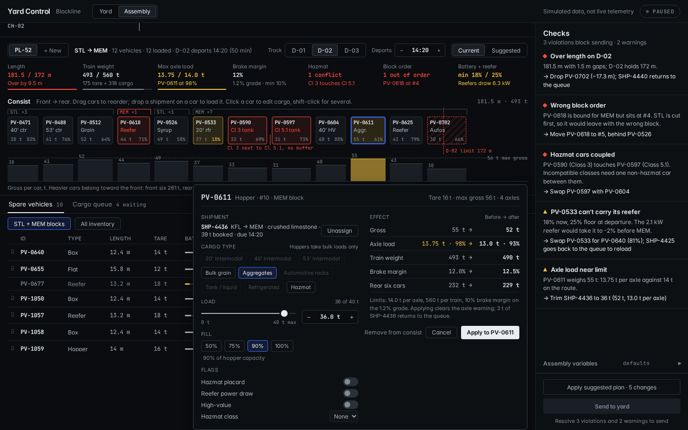

# Autonomous Rail Yard: Yard Control sim

A lab experiment from [Digital Unknown](https://www.digitalunknown.com/spare-parts): an interactive simulator for an autonomous freight hump yard. Modular battery vehicles get humped, sorted, charged, and reassembled into outbound platoons. Every knob is a variable you can tweak.

Each version is a single self-contained HTML file. No build step, no dependencies. Open it in a browser.

## Run it
- **v2 (latest):** `yard-control-v2.html`
- **v1 (frozen):** `yard-control-v1.html`

## What's in v2
- Hump yard track graph with 45° turnouts: receiving R-01..04, hump, bowl B-01..12, charging CH-01/02, departure D-01..03, sidings
- Play, step, speed, live variable sliders, outcome tiles, click-to-open dossiers
- Timeline scrubbing with deterministic replay (edits in replay branch the run)
- Zoom 75–400% with pan and minimap
- 3-lamp signals and state-only color (lime moving, cobalt selected, yellow warning, red fault)
- **Fault injector:** stuck turnouts, retarder failure, charger outage, battery drop, blocked track, from the panel or right-click on the map
- **Assembly view:** build outbound trains from yard inventory, assign cargo per car (type, tonnes, hazmat, reefer), with live checks for length, gross weight, axle load, block order, hazmat adjacency, battery range, and brake margin. Send to yard and the sim pulls, marshals, and departs it.

Keyboard: Space play/pause, ←/→ scrub, +/− zoom, 0 fit.

## Layout
- `yard-control-v2.html`, `yard-control-v1.html`: the builds
- `v2/src/`: v2 source. `python3 v2/build.py` rebuilds `v2/index.html` (copy it to `yard-control-v2.html`)
- `v2/test/`: Playwright tests (`npm i` in `v2/test`, then `node e2e.js`, `scrub.js`, `faults.js`, `anchor.js`, `asm.js`, plus `soak.js` / `fsoak.js`)

Simulated data, not live telemetry.
